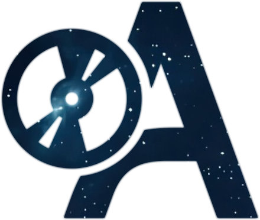

<p align="center">
  
</p>

<h1 align="center">Autorun Windows DLLs</h1>

<p align="center">
  The Windows side of <a href="https://github.com/autorunhq/autorun">Autorun</a>, built from Wine for the Nintendo Switch.<br>
  <sub>Downloaded and kept up to date by Autorun itself.</sub>
</p>

Every module a Windows game expects to find in `system32` (ARM64X) and
`syswow64` (i386), built from Autorun's Wine, with FEX's CPU modules and the
bundled DXVK and VKD3D-Proton. Autorun downloads what it needs from here and
keeps it up to date; nothing here needs to be copied by hand.

- **Built from source, none of it Microsoft's.** Every Wine file is Wine's own
  implementation of Windows, some with changes for the Switch. `NOTICE.md` says
  which, and where each file's source is.
- **Only what changed is downloaded.** Each file has a version, a size and a
  SHA-256 in the manifest, and a card fetches only files whose bytes changed.
- **Matched to the runtime.** A file that needs something a card's Autorun
  doesn't have is left alone until that Autorun is updated.

**Without a network:** download this repository (Code › Download ZIP) and copy
its `switch` folder to the root of the SD card, merging folders.

## Not a piracy or circumvention tool

These files let legitimate Windows programs run on the Switch. They contain no
Windows files, no Microsoft code and no game's files, and nothing here removes
or gets around a game's copy protection, DRM or license checks: the DLLs
implement Windows' programming interfaces, which a game calls the same way on
a PC.

Besides Wine, FEX, DXVK and VKD3D-Proton, the compatibility payload carries
two runtimes games load by name:

- **NVIDIA PhysX** system software (9.13.0604), unmodified, for games built on
  PhysX 2.x, which look for it as a PC's PhysX installer would have left it.
- **XLiveLess**, open source, in place of the library of **Games for Windows
  Live**. Microsoft shut that service down; its client can't be installed any
  more, and couldn't run beside a game on Autorun anyway, because Autorun runs
  Wine as a single process on the Switch (one program at a time; see
  [Autorun's README](https://github.com/autorunhq/autorun#not-a-piracy-or-circumvention-tool)).
  XLiveLess lets a game that was built on it start offline. It stands in for a
  service that no longer exists, not for a store that sells the game.

`NOTICE.md` and each file's manifest entry name its source and license;
anyone passing these files on has to keep to those licenses (Wine's is the
LGPL) and say where the source is.

> **No support for pirated, cracked or modified games, or for third-party
> bundles** that ship a game already packed with Autorun and these files. They
> aren't made by this project and aren't supported or endorsed, and issues about
> them are closed. Get Autorun from its
> [releases](https://github.com/autorunhq/autorun/releases), and let it
> download the files it needs from here.

## Layout

The repository is laid out as the SD card is: `switch/wine/drive_c/` holds the
files, and `switch/wine/horizon-dlls/` the manifest that describes them and
`classes.reg`, the COM classes they serve, which the runtime loads.
`compressed/` holds each file again, zlib-compressed, which is what Autorun
downloads: a fifth of the size, since the ARM64X modules are laid out in
64 KiB blocks that are mostly padding.

## Categories

Each file belongs to the part of Windows it is, whatever program uses it:

| Category | What it covers |
|---|---|
| `legacy-16bit` | Windows 3.x and 9x: the 16-bit modules, VxDs and Win32s old programs and installers load |
| `drivers` | Kernel-mode drivers: the device, bus, file system and network stacks under Windows |
| `core` | The NT layer, the Win32 base and the WoW64 and CPU emulation layers every program runs on |
| `directx-graphics` | Direct3D 1 to 12, DirectDraw, DXGI, Direct2D, the D3DX libraries and the shader compilers |
| `directx-audio` | DirectSound, XAudio2, X3DAudio, XAPOFX, XACT and DirectMusic |
| `directx-input` | DirectInput, XInput, GameInput and game controllers |
| `directx-play` | DirectPlay |
| `directx-media` | DirectShow, Media Foundation, Video for Windows and the codecs they use |
| `translation-layers` | DXVK and VKD3D-Proton: Direct3D 8 to 12 drawn with Vulkan |
| `gaming` | The Game Explorer, Game Bar and the other parts of Windows that are there for games |
| `audio` | Windows audio outside DirectX: the multimedia API, MCI, the audio endpoints, speech and the Switch audio driver |
| `opengl-vulkan` | OpenGL and Vulkan |
| `imaging-text` | GDI+, the image codecs, fonts, text layout and code pages |
| `c-runtime` | The C and C++ runtimes: MSVCRT, the Visual C++ redistributables, the UCRT, ATL and MFC |
| `dotnet` | .NET: the runtime host Mono or .NET is loaded through |
| `com-ole` | COM, OLE, Automation and the script engines |
| `winrt` | The Windows Runtime and its Windows.* components |
| `xml` | MSXML and XmlLite |
| `data` | Databases: ODBC, ADO, OLE DB, the ESE engine and SQLite |
| `network` | Sockets, HTTP, the Internet APIs, telephony, wireless and directory services |
| `security` | Cryptography, certificates, credentials and authentication |
| `shell-ui` | The shell, common controls and dialogs, themes, input, accessibility and the browser control |
| `printing` | Printing |
| `installers` | Installing and updating: Windows Installer, cabinets, patches, side-by-side and Windows Update |
| `programs` | Windows programs: the command prompt, Notepad, the registry editor and the rest |
| `system` | The rest of Windows: services, event logs, performance counters, WMI and devices |

## manifest.json

Autorun reads the manifest from the published branch, and a card keeps the one
it installed from in the same place.

```
schema        format version; Autorun ignores a manifest it does not know
flavor        the runtimes the files are for (arm64x: the x86 and AMD64 ones)
source        repo, commit and Wine version everything was built from
categories    name and description of each category
licenses      the license texts each separately built component brings
files[]       one per file:
  name, path  where it goes, relative to switch/wine
  arch        i386, aarch64 (ARM64X), arm64ec or x86_64
  category    the part of Windows it belongs to
  version     this file's own version; it changes only when its bytes do
  size, sha256, url
              the file and how to check it; url is its raw path on the
              published branch
  compressed  encoding (zlib), size, sha256 and url of the copy to download,
              which unpacks to the file
  source      repo, the commit it was built from, origin (wine, autorun, fex,
              dxvk, vkd3d-proton), the source paths, whether they changed
              since Wine was imported, and for a file built from other
              sources the digest of its recipe
  license     SPDX expression
  requires    flavor, and the features the runtime has to report for the
              file: unixlib:<name> / unixlib32:<name> for a module the
              runtime's unix-call tables name, iface:<name>:<hash> for the
              headers it shares with the runtime. Autorun leaves a file its
              runtime does not satisfy as it is.
  classes[]   COM classes the file serves (clsid, name, threading)
```

## Building

This repository is a submodule of Autorun, at `horizon-dlls/`, and builds from
the Wine in the Autorun checkout around it:

```
git submodule update --init horizon-dlls
horizon-dlls/tools/build-dlls.py
```

It builds in Autorun's `horizon-wine/build-wine-amd64-pe`, configured as
`build-amd64-components.sh` does, and writes over `switch/` only what changed
since the commit the manifest names: a Wine module whose sources, headers,
import libraries or build tools changed, as Wine's make knows them, and a file
built from other sources whose recipe or inputs changed. The rest keep their
bytes and versions. `--all` rebuilds everything. FEX, DXVK and VKD3D-Proton are
built by `tools/build-fex.sh`, `tools/build-dxvk.py` and `tools/build-vkd3d.py`
from their pinned releases; FEX's Horizon patch and the ABI it shares with the
runtime stay in Autorun's `horizon-wine/fex`, and the headers a Wine module
shares with the runtime are listed in `horizon-wine/runtime-interfaces.json`.
Commit and push here, then commit the new `horizon-dlls` in Autorun, so each
Autorun commit names the DLLs that go with it.
